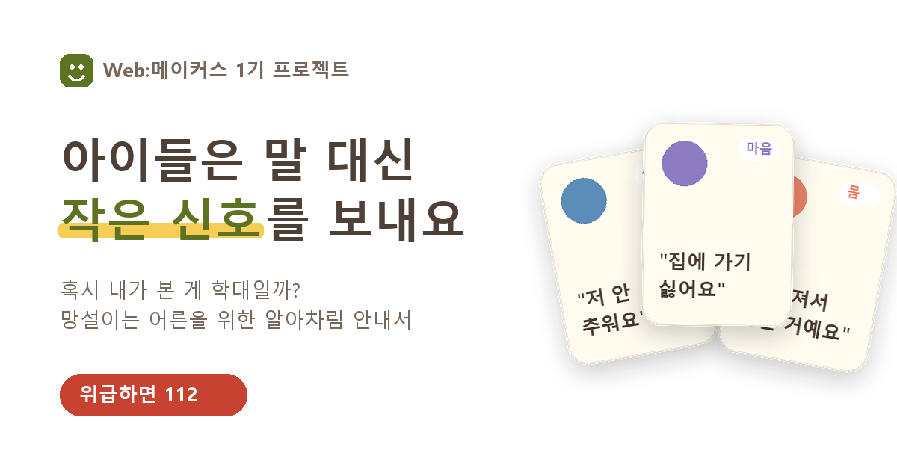

# 🧡 아이의 작은 신호

> 아이들은 말 대신 작은 신호를 보내요.

"혹시 내가 본 게 학대일까?" 확신이 없어 망설이는 어른을 위한 **아동학대 알아차림 안내서**입니다. 아이의 시선으로 신호를 읽고, 지금 내가 할 수 있는 한 걸음을 찾도록 돕습니다.

**🔗 바로 가기: https://ryu-min-ji.github.io/little-signals/**



<br>

## 📌 프로젝트 개요

| 항목 | 내용 |
| --- | --- |
| 프로그램 | 굿네이버스 서울인천권역본부 Web:메이커스 1기, 2주차 SDGs 실천 웹서비스 |
| 주제 | 아동학대 조기 발견과 신고 연결 |
| 관련 SDGs | 16.2 아동에 대한 학대·착취·폭력 근절 |
| 형태 | 개인 프로젝트 (굿네이버스 공식 서비스가 아니며, 학대 여부를 판정하지 않습니다) |

<br>

## 🤔 왜 만들었나요

- 2024년 아동학대 신고는 **5만 242건**, 학대로 판단된 사례는 **2만 4,492건**이었습니다.
- 가해자의 **84.1%가 부모**입니다. 학대는 대부분 집 안에서 일어나 밖에서 보기 어렵습니다.
- 그래서 신고의 **78.5%**(2024년)는 이웃, 친척, 아동 본인처럼 신고 의무가 없는 사람들이 합니다. 평범한 주변 어른의 알아차림이 가장 큰 안전망입니다.
- 하지만 많은 사람이 "확실하지 않은데…", "신분이 알려지면 어쩌지…" 하며 신고를 망설입니다.
- 2024년 한 해 학대로 세상을 떠난 아이는 **30명**입니다.

이 서비스는 **"알아차렸지만 망설이는 순간"**을 돕기 위해 만들었습니다.

<br>

## ✨ 주요 기능

### 1. 아이의 시선 카드 (13장)
- 몸, 마음, 생활, 말 네 가지로 나눈 신호 카드입니다.
- 앞면에는 아이의 목소리("저 안 추워요", "집에 가기 싫어요")가, 뒷면에는 어른이 알아야 할 **뜻과 살펴볼 점**이 있습니다.
- 본 적 있는 신호는 **담기**로 모아 둘 수 있습니다.

### 2. 상황 연습
- 이웃, 학원 강사, 친구의 부모가 겪을 법한 세 가지 상황에서 내가 할 행동을 골라 봅니다.
- 고른 행동마다 이유와 더 좋은 방법을 알려 주고, 마지막에 결과를 보여 줍니다.

### 3. 나의 지킴 계획
- 담은 신호와 아이와의 관계(이웃, 선생님·강사, 친척, 친구의 부모)를 고르면 **3단계 행동 계획**을 보여 줍니다.
  - 아이가 직접 털어놓음, 설명하기 어려운 상처, 비밀 강요 → 지금 112에 신고
  - 여러 신호가 겹침 → 전문가에게 맡기기
  - 신호가 한두 개 → 관심을 갖고 지켜보며 기록하기
- 관계별 조언과 **아이에게 할 말, 하지 말아야 할 말**도 함께 안내합니다.

### 4. 기록 도우미
- 본 것과 들은 것을 날짜, 시간과 함께 기록하고, 신고할 때 쓸 내용으로 한 번에 복사할 수 있습니다.
- 기록은 **사용자의 기기에만 저장**되고 어디로도 전송되지 않습니다.

### 신고 문장 만들기
- 장소, 아이 나이대, 위급 여부를 고르면 담은 신호와 기록을 모아 **112에 그대로 읽으면 되는 신고 문장**을 만들어 줍니다.
- "전화해서 뭐라고 말하지?"라는 망설임을 줄여, 알아차림 → 기록 → 신고 흐름을 완성합니다.

### 어린이용 화면 (나를 지키는 네 가지 약속)
- 아이 눈높이의 쉬운 말로 "내 몸과 마음은 소중해요", "무서운 비밀은 지키지 않아도 돼요" 등을 안내하고, 112 전화와 문자로 바로 연결합니다.
- 2023년 아동 본인의 신고가 1만 건이 넘을 만큼, 아이도 스스로를 지키는 주체라는 관점을 담았습니다.

### 접근성과 공유
- **큰 글씨 모드**로 어르신 이웃도 쉽게 볼 수 있습니다.
- 카드 뒷면마다 **"이렇게 말을 건네 보세요"** 첫마디 예시가 있습니다.
- 나의 지킴 계획을 **이미지 카드**로 저장할 수 있습니다.

### 5. 망설여질 때 Q&A
- 확실하지 않아도 신고할 수 있는지, 신분이 알려지는지, 신고하면 아이가 부모와 떨어지는지 등 자주 하는 걱정에 답합니다.

### 6. 굿네이버스와 연결, 지킴이 약속
- 전국 36개 아동보호전문기관을 운영하는 굿네이버스의 아동보호 사업으로 연결해, 알아차림이 신고와 회복으로 이어지게 합니다.
- 이름을 넣으면 **"우리 동네 아이 지킴이" 카드 이미지**를 만들어 공유할 수 있습니다. (이름은 저장되지 않습니다.)
- 화면 위쪽에는 언제나 **112 신고** 버튼이 있습니다.

### 디자인
- 굿네이버스 웹사이트의 디자인 언어(Pretendard, 그린 `#89A230`, 브라운 `#564F49`, 둥근 필 버튼, 배너 슬라이드)를 참고했습니다.
- 아이의 목소리만 손글씨체(Gaegu)로 표현해 '아이의 시선'을 강조했습니다.

<br>

## 🛠️ 기술

- **HTML / CSS / JavaScript** (프레임워크 없이 순수 코드)
- 서버와 데이터베이스 없이 동작 (GitHub Pages로 배포)
- 기록 저장: 브라우저 localStorage (기기 안에만 저장)
- 폰트: Pretendard, Black Han Sans, Gaegu
- 반응형 레이아웃, 키보드 조작, '동작 줄이기' 설정 지원

```
little-signals/
├── index.html    # 페이지 구조
├── style.css     # 디자인
├── app.js        # 카드, 지킴 계획, 기록 기능
├── og.png        # 링크 공유 미리보기 이미지
└── favicon.svg   # 브라우저 탭 아이콘
```

<br>

## ⚠️ 알아 두세요

- 이 서비스는 **학대 여부를 판정하지 않습니다.** 신호 하나만으로 학대라고 단정할 수 없으며, 판단은 신고 후 전문가가 합니다.
- 아이가 위험하다고 느껴지면 망설이지 말고 **112**에 신고해 주세요.

<br>

## 📚 자료 출처

- [2024 아동학대 연차보고서 (경향신문)](https://www.khan.co.kr/article/202508291441001/)
- [가해자 80% 이상이 부모 (세계일보)](https://www.segye.com/newsView/20260712512392)
- [비신고의무자 신고 비율과 신고를 망설이는 이유 (한국일보)](https://www.hankookilbo.com/news/article/A2025083116020003114)
- [아동학대 개념 및 유형 (인천광역시)](https://www.incheon.go.kr/welfare/WE020431)
- [아이지킴콜 112 (서울시 미디어허브)](https://mediahub.seoul.go.kr/archives/1297482)
- [아동학대 신고와 공익신고 (국민권익위원회)](https://m.korea.kr/briefing/pressReleaseView.do?newsId=156581226)
- [GN 세이프 스타트 (굿네이버스 보도자료)](https://www.goodneighbors.kr/story/press/8712/view.gn)
- [굿네이버스 사례관리 성과 (한국NGO신문)](https://www.ngonews.kr/news/articleView.html?idxno=243472)

<br>

---

굿네이버스 서울인천권역본부 Web:메이커스 1기 · 류민지
